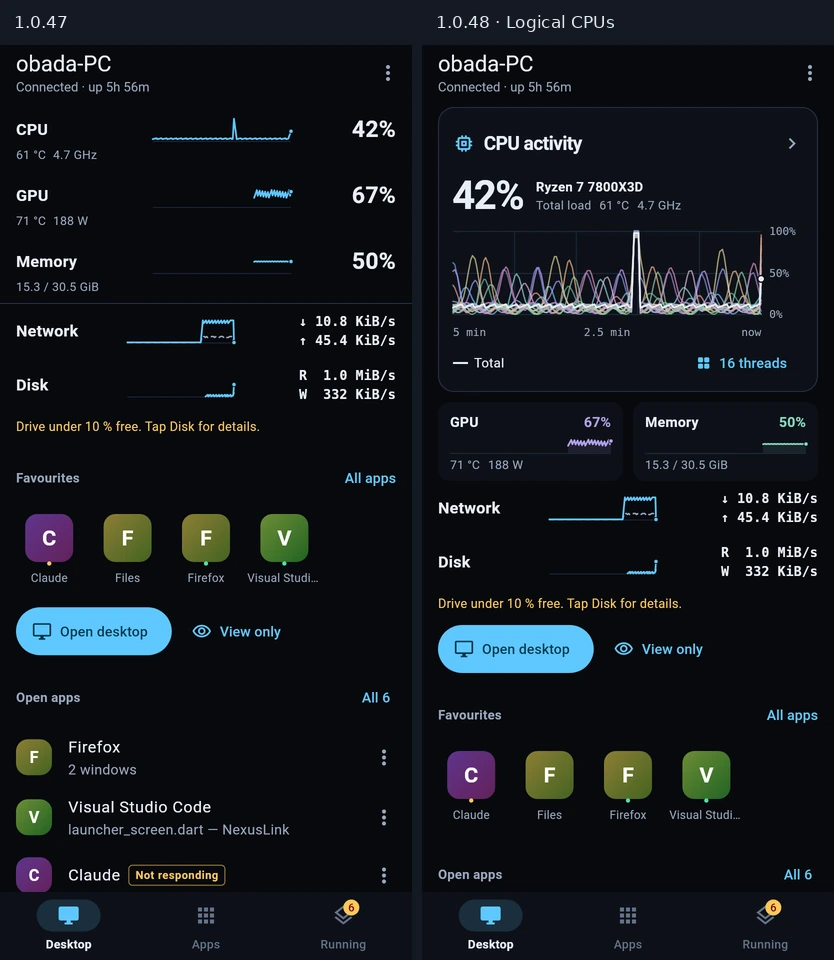
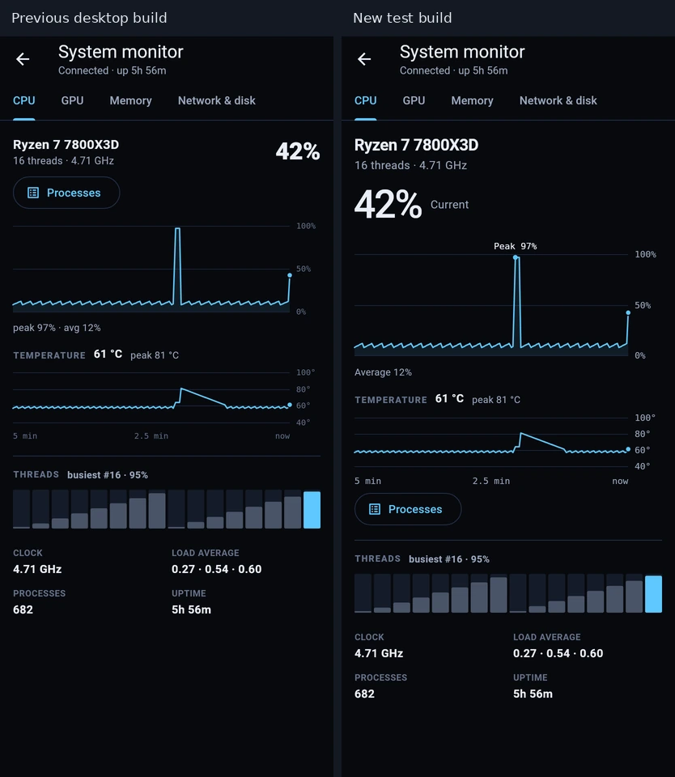
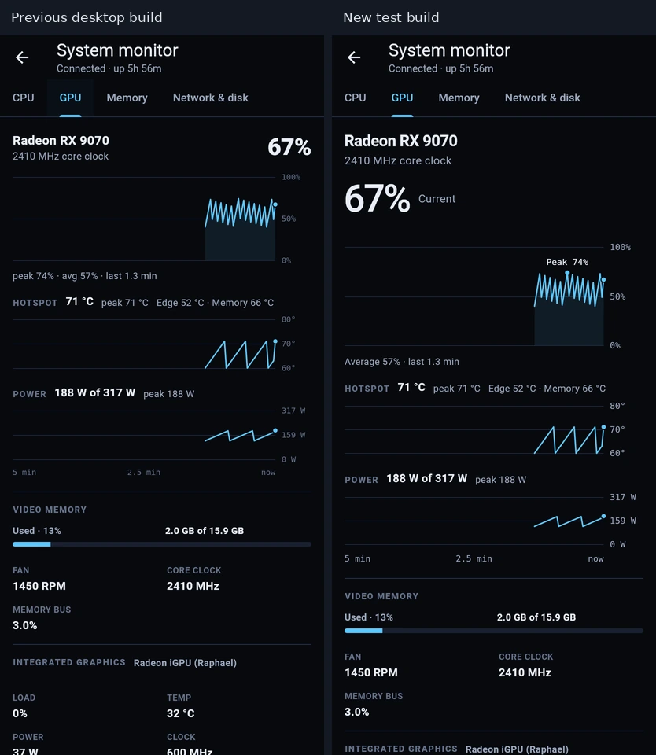
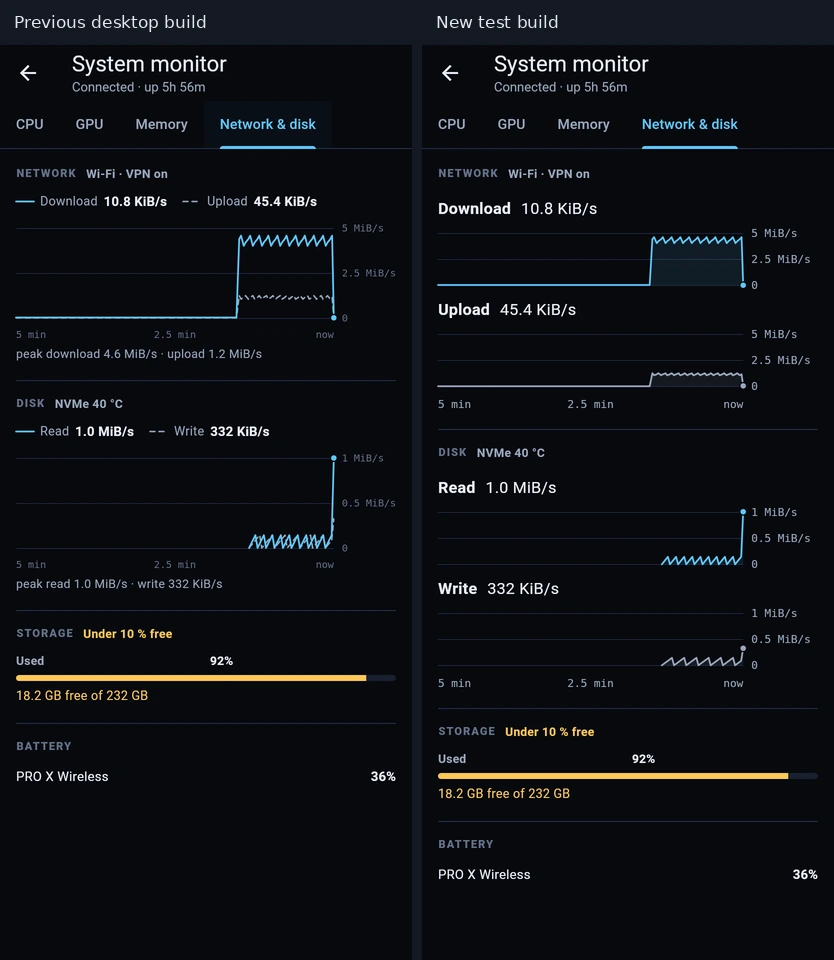

# Phone chart design

These captures compare the Desktop implementation in `935d864` on the left with the new Flutter screens on the right. Both runs use the same monitor fixture at 412 × 915 dp.

### Desktop

Each row opens the corresponding monitor page. The center trace shows the last five minutes. The right edge holds the latest reading or both transfer rates. At large text sizes the trace moves beneath the readings.

### CPU

The hardware name and load precede the five-minute plot. The peak label sits on the highest retained sample. The temperature plot uses the same time axis. Processes opens below the plots. Hold and drag on either plot to see the corresponding readings across the page.

### GPU

Load, hotspot and power share plot edges and time. The empty interval at the left shows how much history has been collected. The power axis uses the reported cap. Missing sensors get a text label.

### Network and disk

Download and Upload use separate labeled plots with identical rate scales. Read and Write use the same arrangement. All four use one five-minute timeline. Rates use binary units. Storage shows an actionable warning when less than ten percent is free.

### Data and acceptance

- Use the existing monitor snapshot and timestamped pushes. Keep irregular sampling, short spikes and the latest real sample. A gap longer than 15 seconds breaks the trace and has no inspection value.
- Use one selected host timestamp per monitor page. Releasing the gesture clears the cursor. Disconnected headline values read “Last reading.”
- Check Desktop drill-down, Back, the CPU process list, and synchronized inspection. Render with normal and double text size and exercise all tabs on narrow phones.
- Check notification taps with two PCs and two outstanding requests in one session, Continue after a nested module, and App info after an agent exits. Publish the signed Android test build with an incremented version code.
