# Master Execution Plan: Unified Remote Control Application
## "NexusLink" — Replace TeamViewer, AnyDesk, Input Leap & SSH

---

> [!IMPORTANT]
> **How to Use This Plan**
> Each phase contains one or more **Agent Prompt Blocks** — exact, copy-paste instructions for your OpenCode terminal agent. Feed them sequentially. Do **not** skip ahead. Each block is self-contained and scoped to prevent the agent from hallucinating out-of-bounds work.

---

## Background & Architecture Overview

```
┌──────────────────────────────────────────────────────────────────┐
│                        ARCHITECTURE                              │
│                                                                  │
│  ┌─────────────────────┐         ┌──────────────────────────┐   │
│  │   DESKTOP HOST      │         │   MOBILE CLIENT          │   │
│  │  (Tauri 2.0 + Bun)  │◄───────►│  (Next.js PWA / Native)  │   │
│  │                     │ WebRTC  │                          │   │
│  │  ┌───────────────┐  │ /WS     │  ┌────────────────────┐ │   │
│  │  │ OS Hook Layer │  │         │  │ Component Renderer │ │   │
│  │  │  (Rust sidecar│  │         │  │  - Terminal UI     │ │   │
│  │  │  + TS bridge) │  │         │  │  - File Browser    │ │   │
│  │  └───────────────┘  │         │  │  - Task Manager    │ │   │
│  │  ┌───────────────┐  │         │  └────────────────────┘ │   │
│  │  │ Screen Capture│  │         │  ┌────────────────────┐ │   │
│  │  │ + Input Inject│  │         │  │  Mirror Mode       │ │   │
│  │  └───────────────┘  │         │  │  (WebRTC stream)   │ │   │
│  │  ┌───────────────┐  │         │  └────────────────────┘ │   │
│  │  │ RPC Server    │  │         │  ┌────────────────────┐ │   │
│  │  │  (Bun WS)     │  │         │  │ Gesture Engine     │ │   │
│  │  └───────────────┘  │         │  └────────────────────┘ │   │
│  └─────────────────────┘         └──────────────────────────┘   │
└──────────────────────────────────────────────────────────────────┘
```

**Technology Decisions (Final):**
| Layer | Technology | Rationale |
|---|---|---|
| Runtime | Bun 1.x | Native TS, fast I/O, built-in WS server |
| Desktop Shell | **Tauri 2.0** | Mature, cross-platform (Win/Linux), Rust sidecar for OS hooks |
| OS Hook Sidecar | Rust (compiled binary) | Screen capture, input injection — needs native perf |
| RPC Bridge | Tauri IPC + Bun WebSocket server | UI↔Backend comms |
| Frontend | Next.js 14 (App Router) | Serves both desktop dashboard & mobile client |
| Mobile UI | Next.js PWA + React | Installable, no app store required |
| Streaming | WebRTC (peer-to-peer) + WebSocket (signaling) | Low-latency screen stream |
| Auth | ECDH key exchange + TOTP pairing | Secure, no central server required |

> [!NOTE]
> **Why Tauri 2.0 over Electrobun?** Electrobun is still pre-production. Tauri 2.0 has a stable mobile bridge, proven Windows/Linux screen-capture APIs via its Rust ecosystem, and a large plugin ecosystem. This is the safer choice for a production-grade tool.

---

## Phase 1: Environment Initialization

**Goal:** Bootstrap the monorepo, install runtimes, scaffold Tauri 2.0 with Bun, and validate the dev environment on both Windows and Linux.

---

### 1.1 — Monorepo & Runtime Bootstrap

> **Agent Prompt 1.1**
> ```
> TASK: Initialize the NexusLink monorepo.
>
> You are setting up the project scaffold only. Do not write any application logic.
>
> Steps:
> 1. Create a root directory called `nexuslink/` with the following structure:
>    nexuslink/
>    ├── apps/
>    │   ├── desktop/          # Tauri 2.0 desktop host
>    │   └── mobile-client/    # Next.js 14 PWA mobile client
>    ├── packages/
>    │   ├── rpc-types/        # Shared TypeScript types for RPC messages
>    │   ├── gesture-engine/   # Gesture normalization library (pure TS)
>    │   └── ui-components/    # Shared React components (mobile UI primitives)
>    ├── sidecar/              # Rust OS-hook binary source
>    ├── bun.lockb
>    ├── package.json          # Bun workspace root
>    └── turbo.json            # Turborepo config
>
> 2. Initialize a Bun workspace at the root: `bun init -y` then configure `package.json` workspaces to point to `apps/*` and `packages/*`.
>
> 3. Install Turborepo as a dev dependency at root: `bun add -D turbo`
>
> 4. Create `turbo.json` with pipelines for: `dev`, `build`, `lint`, `typecheck`.
>
> 5. In `apps/desktop/`, scaffold a new Tauri 2.0 project using the official CLI:
>    `bunx create-tauri-app@latest . --template vanilla-ts --manager bun --identifier com.nexuslink.desktop`
>    Then immediately remove the default Tauri frontend scaffold — we will replace it with Next.js.
>
> 6. In `apps/mobile-client/`, scaffold a Next.js 14 app:
>    `bunx create-next-app@latest . --ts --app --no-tailwind --eslint --src-dir`
>
> 7. In each `packages/*` directory, run `bun init -y` and set `"main": "src/index.ts"`.
>
> 8. Configure TypeScript project references: root `tsconfig.json` should reference all workspace packages.
>
> Output: A fully initialized monorepo that can be opened. Do not add any feature code. Stop after the scaffold is complete and list all created files.
> ```

---

### 1.2 — Tauri + Next.js Integration

> **Agent Prompt 1.2**
> ```
> TASK: Wire the Next.js 14 app as the Tauri 2.0 frontend for the desktop host.
>
> Context: We are inside `apps/desktop/`. The Tauri project was scaffolded in the previous step. Do not touch `apps/mobile-client/` or any `packages/`.
>
> Steps:
> 1. Configure `src-tauri/tauri.conf.json`:
>    - Set `build.devUrl` to `http://localhost:3000` (the Next.js dev server port).
>    - Set `build.beforeDevCommand` to `bun run dev` (runs Next.js).
>    - Set `build.beforeBuildCommand` to `bun run build`.
>    - Set `app.windows[0].title` to "NexusLink Host".
>    - Set `app.windows[0].width` to 1200, `height` to 800.
>
> 2. In `apps/desktop/`, create a `package.json` script:
>    - `"dev": "next dev"` (port 3000)
>    - `"tauri": "tauri dev"` (starts Tauri, which auto-launches Next.js)
>
> 3. Install required Tauri plugins in `src-tauri/Cargo.toml`:
>    - `tauri-plugin-shell` (for sidecar process management)
>    - `tauri-plugin-fs` (for file system access)
>    - `tauri-plugin-http` (for outbound requests)
>    - `tauri-plugin-notification`
>
> 4. Register all plugins in `src-tauri/src/main.rs` using the `.plugin()` builder pattern.
>
> 5. Create a minimal Next.js page at `src/app/page.tsx` that renders: `<h1>NexusLink Host — Connected</h1>` as a smoke test.
>
> 6. Verify the integration compiles cleanly by running `bun run tauri dev` and confirming the window opens. Report any compilation errors but do not fix Rust errors — only TypeScript/config errors.
>
> Stop after verification. Do not add features.
> ```

---

### 1.3 — Rust Sidecar Scaffold

> **Agent Prompt 1.3**
> ```
> TASK: Scaffold the OS-hook Rust sidecar binary inside `sidecar/`.
>
> Context: The sidecar is a separate Rust binary (not a Tauri app) that will be compiled and bundled alongside the Tauri app. It handles screen capture and input injection. Do not implement any capture or injection logic yet — only the scaffold and IPC channel.
>
> Steps:
> 1. In `sidecar/`, run `cargo init --name nexuslink-sidecar`.
>
> 2. Add to `sidecar/Cargo.toml`:
>    - `serde = { version = "1", features = ["derive"] }`
>    - `serde_json = "1"`
>    - `tokio = { version = "1", features = ["full"] }`
>    - `anyhow = "1"`
>
> 3. In `sidecar/src/main.rs`, implement a minimal stdin/stdout JSON-RPC loop:
>    - The binary reads newline-delimited JSON from stdin.
>    - Each message has shape: `{ "id": u64, "method": string, "params": serde_json::Value }`
>    - The binary writes responses to stdout: `{ "id": u64, "result": serde_json::Value, "error": Option<string> }`
>    - For all unrecognized methods, return: `{ "error": "method not implemented" }`
>    - Implement one test method: `"ping"` → returns `{ "result": "pong" }`.
>
> 4. Configure the sidecar in `apps/desktop/src-tauri/tauri.conf.json`:
>    - Add the sidecar binary path to `bundle.externalBin`.
>    - Add the `shell:allow-spawn` and `shell:allow-execute` permissions for the sidecar.
>
> 5. Run `cargo build --release` inside `sidecar/` and confirm it compiles.
>
> Stop here. Do not implement screen capture.
> ```

---

## Phase 2: RPC Bridge & Core OS Architecture

**Goal:** Build the high-speed, type-safe communication backbone between the Next.js UI, the Tauri Rust core, and the OS-hook sidecar. Also implement the file system and process management backends.

---

### 2.1 — Shared RPC Type Definitions

> **Agent Prompt 2.1**
> ```
> TASK: Define all shared RPC message types in `packages/rpc-types/src/index.ts`.
>
> Context: This package is imported by both the desktop frontend (Next.js) and the mobile client. It must have zero runtime dependencies — types only.
>
> Define the following TypeScript types and interfaces:
>
> 1. `RpcMethod` — a string union of ALL RPC methods the system will support:
>    'fs.list' | 'fs.read' | 'fs.write' | 'fs.delete' | 'fs.move' |
>    'process.list' | 'process.kill' | 'process.spawn' |
>    'terminal.create' | 'terminal.input' | 'terminal.resize' | 'terminal.kill' |
>    'screen.startCapture' | 'screen.stopCapture' | 'screen.getMetadata' |
>    'input.mouseMove' | 'input.mouseClick' | 'input.mouseScroll' | 'input.keyEvent' |
>    'session.pair' | 'session.authenticate' | 'session.heartbeat' | 'session.disconnect' |
>    'system.getInfo' | 'system.getPerf'
>
> 2. `RpcRequest<M extends RpcMethod>` — generic request envelope with `id`, `method`, `params`.
> 3. `RpcResponse<T>` — response envelope with `id`, `result?`, `error?`.
> 4. Define `Params` and `Result` mapped types for each method above. For example:
>    - `fs.list` params: `{ path: string; showHidden?: boolean }`, result: `FileEntry[]`
>    - `process.list` params: `{}`, result: `ProcessEntry[]`
>    - `terminal.create` params: `{ cols: number; rows: number; shell?: string }`, result: `{ terminalId: string }`
>    - `screen.startCapture` params: `{ quality: 'low'|'medium'|'high'; fps: number }`, result: `{ streamId: string }`
>    - `input.mouseScroll` params: `{ deltaX: number; deltaY: number; x: number; y: number }`, result: `{ ok: boolean }`
>
> 5. Define supporting types: `FileEntry`, `ProcessEntry`, `SystemInfo`, `PerfSnapshot`.
>
> 6. Export a `WsMessage` discriminated union for WebSocket frames:
>    `{ type: 'rpc-request' | 'rpc-response' | 'stream-frame' | 'terminal-output' | 'perf-update' }`
>
> All types must be exported from the package index. No implementation code. Types only.
> ```

---

### 2.2 — Tauri IPC Command Layer

> **Agent Prompt 2.2**
> ```
> TASK: Implement the Tauri IPC command handlers in `apps/desktop/src-tauri/src/`.
>
> Context: Tauri IPC commands are Rust functions decorated with `#[tauri::command]`. The Next.js frontend calls them via `invoke()`. Do NOT implement the actual OS logic yet — implement the routing skeleton and wire it to the sidecar.
>
> Steps:
> 1. Create `src-tauri/src/commands/mod.rs` as the module root.
> 2. Create `src-tauri/src/commands/fs.rs` with stubbed Tauri commands:
>    - `list_directory(path: String) -> Result<Vec<FileEntry>, String>`
>    - `read_file(path: String) -> Result<String, String>`
>    - `write_file(path: String, content: String) -> Result<(), String>`
>    - `delete_path(path: String) -> Result<(), String>`
>    Each stub returns `Err("not implemented".to_string())`.
> 3. Create `src-tauri/src/commands/process.rs` with:
>    - `list_processes() -> Result<Vec<ProcessEntry>, String>`
>    - `kill_process(pid: u32) -> Result<(), String>`
> 4. Create `src-tauri/src/commands/sidecar.rs`:
>    - On app startup, spawn the `nexuslink-sidecar` binary using `tauri-plugin-shell`.
>    - Maintain a global `Arc<Mutex<ChildStdin>>` for sending requests to the sidecar.
>    - Implement `send_to_sidecar(method: String, params: Value) -> Result<Value, String>` that:
>      a. Writes a JSON-RPC request to the sidecar's stdin.
>      b. Awaits a matching response from stdout (match by `id`).
>      c. Returns the `result` or propagates the `error`.
>    - Use a `HashMap<u64, oneshot::Sender<Value>>` for in-flight request tracking.
> 5. Register all commands in `src-tauri/src/main.rs` via `.invoke_handler(tauri::generate_handler![...])`.
> 6. Compile and confirm zero errors. Stubs returning errors are acceptable.
> ```

---

### 2.3 — Bun WebSocket RPC Server

> **Agent Prompt 2.3**
> ```
> TASK: Build the Bun WebSocket RPC server in `apps/desktop/src/server/`.
>
> Context: This server runs inside the Tauri app process (not the sidecar) as a Bun background worker. It listens on a local port (default: 45678) and is the entry point for remote WebSocket connections from the mobile client. The Tauri Next.js frontend also uses this server for real-time updates.
>
> Steps:
> 1. Create `apps/desktop/src/server/rpc-server.ts`:
>    - Use `Bun.serve()` with WebSocket upgrade support.
>    - Maintain a `Map<string, ServerWebSocket>` of connected sessions.
>    - On message, parse as `WsMessage` from `@nexuslink/rpc-types`.
>    - Route `rpc-request` messages to a `dispatch(method, params)` function.
>    - `dispatch()` is a switch/case over `RpcMethod` — all cases return `{ error: 'not implemented' }` for now.
>    - Send `rpc-response` back to the originating socket.
>
> 2. Create `apps/desktop/src/server/handlers/fs.ts`:
>    - Implement `handleFsList(params)` using Bun's native `fs` module.
>    - Return an array of `FileEntry` objects with: `name`, `path`, `size`, `isDirectory`, `modifiedAt`, `mimeType`.
>    - Use `Bun.file()` and `fs.readdir()` with `{ withFileTypes: true }`.
>
> 3. Create `apps/desktop/src/server/handlers/process.ts`:
>    - On Linux: parse `/proc/` filesystem to list processes (pid, name, cpuPercent, memMb).
>    - On Windows: use `Bun.spawnSync(['tasklist', '/FO', 'CSV'])` and parse the CSV output.
>    - Export `listProcesses(): Promise<ProcessEntry[]>`.
>
> 4. Wire `handleFsList` and `listProcesses` into the `dispatch()` router.
>
> 5. Create `apps/desktop/src/server/index.ts` as the server entry point. Export a `startRpcServer(port: number)` function.
>
> 6. Add a Bun script in `apps/desktop/package.json`: `"server": "bun run src/server/index.ts"`.
>
> Do not implement authentication yet. Do not touch screen capture or input injection.
> ```

---

### 2.4 — Terminal Backend (PTY)

> **Agent Prompt 2.4**
> ```
> TASK: Implement the terminal PTY (Pseudo-Terminal) backend in the Rust sidecar.
>
> Context: We are inside `sidecar/src/`. The stdin/stdout JSON-RPC loop is already implemented. We need to add PTY management so the mobile client can open a real shell session on the host PC.
>
> Steps:
> 1. Add to `sidecar/Cargo.toml`:
>    - `portable-pty = "0.8"` (cross-platform PTY: works on Windows and Linux)
>    - `uuid = { version = "1", features = ["v4"] }`
>
> 2. Create `sidecar/src/terminal.rs`:
>    - Define `TerminalSession { id: String, master: Box<dyn MasterPty>, reader_thread: JoinHandle<()> }`.
>    - Implement `create_terminal(cols: u16, rows: u16, shell: Option<String>) -> String`:
>      - Spawns a PTY pair using `portable_pty`.
>      - Launches the default shell (`/bin/bash` on Linux, `cmd.exe` or `powershell.exe` on Windows).
>      - Spawns a Tokio reader task that reads PTY output and writes it to stdout as: `{ "type": "terminal-output", "terminalId": "...", "data": "<base64>" }`.
>      - Returns the session UUID.
>    - Implement `write_to_terminal(id: &str, data: &[u8])` — writes to the PTY master.
>    - Implement `resize_terminal(id: &str, cols: u16, rows: u16)` — calls `pty.resize()`.
>    - Implement `kill_terminal(id: &str)` — drops the session.
>    - Store sessions in a `HashMap<String, TerminalSession>` wrapped in `Arc<Mutex<>>`.
>
> 3. In `sidecar/src/main.rs`, add these methods to the RPC dispatch:
>    - `"terminal.create"` → calls `create_terminal`, returns `{ "terminalId": "..." }`
>    - `"terminal.input"` → calls `write_to_terminal`
>    - `"terminal.resize"` → calls `resize_terminal`
>    - `"terminal.kill"` → calls `kill_terminal`
>
> 4. Back in `apps/desktop/src/server/handlers/terminal.ts`:
>    - Implement `handleTerminalCreate(params, socket)`: calls `send_to_sidecar('terminal.create', params)` and stores `terminalId → socket` mapping.
>    - Implement `handleTerminalInput(params)`: forwards to sidecar.
>    - Forward `terminal-output` events from the sidecar stdout reader to the correct WebSocket client.
>
> 5. Wire all terminal handlers into the Bun RPC server dispatch.
>
> Compile both Rust and TypeScript. Fix any compilation errors. Do not implement screen capture.
> ```

---

## Phase 3: Mobile Client & Component UIs

**Goal:** Build the mobile-first Next.js PWA with four native component UIs: Terminal, File Browser, Task Manager, and System Monitor. Implement the toggle between Component Mode and Mirror Mode.

---

### 3.1 — Mobile Client Foundation & PWA Setup

> **Agent Prompt 3.1**
> ```
> TASK: Configure `apps/mobile-client/` as a Progressive Web App (PWA) and establish the connection layer to the host RPC server.
>
> Context: We are inside `apps/mobile-client/`. This is a Next.js 14 App Router project. It will be served from the host machine and accessed by the mobile browser over the local network (or via a relay).
>
> Steps:
> 1. Install dependencies:
>    `bun add next-pwa zustand @xterm/xterm @xterm/addon-fit @xterm/addon-web-links`
>    `bun add -D @types/node`
>
> 2. Configure PWA in `next.config.ts` using `next-pwa`. Set:
>    - `dest: 'public'`
>    - `disable: process.env.NODE_ENV === 'development'`
>    - `runtimeCaching` for all API routes.
>
> 3. Create `public/manifest.json` with:
>    - `name: "NexusLink"`, `short_name: "NexusLink"`
>    - `display: "standalone"`, `theme_color: "#0a0a0f"`
>    - `icons` array with placeholder 192x192 and 512x512 entries (use SVG data URIs).
>
> 4. Create `src/lib/rpc-client.ts`:
>    - Exports a `RpcClient` class.
>    - Constructor takes `wsUrl: string`.
>    - Maintains a WebSocket connection with auto-reconnect (exponential backoff, max 5 retries).
>    - Implements `call<M extends RpcMethod>(method: M, params: Params<M>): Promise<Result<M>>`:
>      - Generates a unique request ID.
>      - Sends a `WsMessage` of type `rpc-request`.
>      - Returns a Promise that resolves when the matching `rpc-response` arrives.
>      - Rejects after a 10-second timeout.
>    - Implements `subscribe(type: WsMessage['type'], handler: (msg) => void): () => void` for event streaming.
>
> 5. Create `src/store/connection.ts` using Zustand:
>    - State: `{ status: 'disconnected' | 'connecting' | 'connected', hostUrl: string | null, client: RpcClient | null }`
>    - Actions: `connect(url: string)`, `disconnect()`.
>
> 6. Create `src/app/layout.tsx` with:
>    - Dark background `#0a0a0f`, system font stack with Inter fallback.
>    - PWA meta tags in `<head>`.
>    - A `<ConnectionProvider>` wrapper that reads `hostUrl` from localStorage on mount and auto-connects.
>
> 7. Create `src/app/page.tsx` as the Home screen:
>    - If not connected: show a "Connect to Host" form (URL input + Connect button).
>    - If connected: show a grid of 4 launcher icons: Terminal, Files, Processes, System.
>    - Add a "Mirror Mode" toggle button in the top-right corner (non-functional stub for now).
>
> Do not build the component UIs yet. Stop after the home screen renders correctly in a browser.
> ```

---

### 3.2 — Mobile Terminal Component

> **Agent Prompt 3.2**
> ```
> TASK: Build the mobile-optimized Terminal component in `apps/mobile-client/src/app/terminal/`.
>
> Context: The RPC client is implemented. The terminal backend (PTY) is running in the sidecar. This component must feel like a native mobile terminal app, not a pixel-streamed CMD window.
>
> Steps:
> 1. Create `src/app/terminal/page.tsx`.
>
> 2. On component mount:
>    - Call `rpcClient.call('terminal.create', { cols: 80, rows: 24, shell: undefined })` to get a `terminalId`.
>    - Subscribe to `terminal-output` WebSocket events filtered by `terminalId`.
>
> 3. Integrate `@xterm/xterm` terminal renderer:
>    - Initialize an `XTerm` instance with theme: black background, green foreground, cursor blinking.
>    - Use `FitAddon` to fit the terminal to the available screen height minus the keyboard toolbar.
>    - Write incoming `terminal-output` data (base64 decoded) directly to the xterm instance.
>
> 4. Implement the mobile keyboard toolbar — a `<div>` fixed above the software keyboard with buttons:
>    `Tab` | `Ctrl` | `Alt` | `Esc` | `↑` | `↓` | `←` | `→`
>    Each button calls `rpcClient.call('terminal.input', { terminalId, data: '<escape-sequence>' })`.
>
> 5. Wire the xterm `onData` handler to send user keystrokes via `rpcClient.call('terminal.input', ...)`.
>
> 6. On browser resize or orientation change, call `rpcClient.call('terminal.resize', { terminalId, cols, rows })` with recalculated dimensions from FitAddon.
>
> 7. On component unmount, call `rpcClient.call('terminal.kill', { terminalId })`.
>
> 8. Style requirements:
>    - Full-screen dark UI, monospace font (JetBrains Mono from Google Fonts).
>    - A top bar showing: "Terminal — [host name]" with a close (X) button.
>    - The keyboard toolbar must have a subtle glass-morphism effect (blurred background).
>    - All touch targets must be minimum 44x44px.
>
> Do not implement other component UIs. Stop after the terminal page is complete.
> ```

---

### 3.3 — Mobile File Browser Component

> **Agent Prompt 3.3**
> ```
> TASK: Build the mobile-optimized File Browser component in `apps/mobile-client/src/app/files/`.
>
> Context: The `fs.*` RPC handlers are implemented in the Bun server. Build a native-feeling mobile file explorer.
>
> Steps:
> 1. Create `src/app/files/page.tsx`.
>
> 2. State management (local React state):
>    - `currentPath: string` (starts at user home directory, fetched via `system.getInfo`).
>    - `entries: FileEntry[]`.
>    - `history: string[]` (for back-navigation).
>    - `selected: Set<string>` (for multi-select operations).
>    - `viewMode: 'list' | 'grid'`.
>
> 3. On mount and on `currentPath` change: call `rpcClient.call('fs.list', { path: currentPath, showHidden: false })`.
>
> 4. Render a top navigation bar:
>    - Back button (disabled at root).
>    - Current path as a horizontally scrollable breadcrumb.
>    - View toggle (list/grid icon).
>    - Hidden files toggle.
>
> 5. Render entries:
>    - List mode: each row shows an icon (folder vs file type), name, size, and modified date.
>    - Grid mode: 3-column grid with icon and truncated name.
>    - Tapping a directory navigates into it.
>    - Long-pressing an entry enters multi-select mode.
>
> 6. Implement a context action bar (appears when items are selected):
>    - Buttons: Copy, Move, Delete, Rename.
>    - Implement Delete: call `rpcClient.call('fs.delete', { path })` with confirmation dialog.
>    - Stub Copy and Move (show "not implemented" toast).
>
> 7. Implement pull-to-refresh to re-fetch the current directory.
>
> 8. Style requirements:
>    - Consistent dark theme with the rest of the app.
>    - Smooth slide-in transition when navigating into a directory.
>    - File type icons: use Unicode emoji as placeholders (📁 folder, 📄 file, 🖼️ image, etc.).
>    - Empty state: centered icon + "This folder is empty" message.
>
> Stop after the file browser page is complete.
> ```

---

### 3.4 — Task Manager & System Monitor Components

> **Agent Prompt 3.4**
> ```
> TASK: Build the Task Manager and System Monitor components.
>
> === PART A: Task Manager (`src/app/processes/page.tsx`) ===
>
> 1. On mount, call `rpcClient.call('process.list', {})`. Set up a 3-second polling interval.
>
> 2. Render a searchable, sortable list of processes:
>    - Each row: process name, PID, CPU%, Memory (MB).
>    - Sort by: Name, CPU (default desc), Memory.
>    - Search bar filters by name (client-side).
>
> 3. Tapping a process shows a bottom sheet with:
>    - Process details (name, PID, full path if available).
>    - A red "Force Kill" button that calls `rpcClient.call('process.kill', { pid })` with a confirmation dialog.
>
> 4. Style: CPU bars as colored progress bars (green < 30%, yellow < 70%, red >= 70%). Animate value changes.
>
> === PART B: System Monitor (`src/app/system/page.tsx`) ===
>
> 1. Subscribe to `perf-update` WebSocket events (host pushes these every 1 second).
>    Also implement an initial fetch via `rpcClient.call('system.getPerf', {})`.
>
> 2. Display real-time charts for:
>    - CPU usage (%) — line chart, last 60 samples.
>    - RAM usage (%) — line chart, last 60 samples.
>    - Network in/out (KB/s) — dual-line chart.
>    - Disk read/write (MB/s) — dual-line chart.
>
> 3. Use a pure CSS/SVG sparkline chart component (no external chart library). Implement a `<Sparkline data={number[]} color={string} />` component in `packages/ui-components/`.
>
> 4. Display static system info panel at the top: OS, Hostname, CPU model, Total RAM, Uptime.
>    Fetch once on mount via `rpcClient.call('system.getInfo', {})`.
>
> 5. Style: Each metric in a card with a glassmorphism effect. Dark gradient backgrounds.
>
> Stop after both pages are complete.
> ```

---

### 3.5 — Mirror Mode & View Toggle

> **Agent Prompt 3.5**
> ```
> TASK: Implement Mirror Mode and the Component/Mirror toggle in `apps/mobile-client/`.
>
> Context: Mirror Mode streams the host screen to the mobile browser via WebRTC. The Gesture Engine (Phase 4) will handle touch-to-mouse translation. For now, implement the WebRTC stream receiver and the UI toggle. The host-side screen capture will be implemented in Phase 4.
>
> Steps:
> 1. Create `src/lib/webrtc-client.ts`:
>    - `WebRtcClient` class.
>    - `connect(signalingWsUrl: string): Promise<MediaStream>`:
>      - Opens a WebSocket to the signaling endpoint (`ws://host:45678/signal`).
>      - Creates an `RTCPeerConnection` with STUN server: `stun:stun.l.google.com:19302`.
>      - Handles the offer/answer/ICE-candidate exchange via the signaling WebSocket.
>      - Resolves with the incoming `MediaStream` when the `track` event fires.
>    - `disconnect()`: closes the peer connection.
>
> 2. Create `src/app/mirror/page.tsx`:
>    - State: `{ stream: MediaStream | null, status: 'connecting' | 'live' | 'error' }`.
>    - On mount: call `rpcClient.call('screen.startCapture', { quality: 'medium', fps: 30 })`, then call `webRtcClient.connect(...)`.
>    - Render a `<video autoPlay playsInline muted ref={videoRef} />` element that fills the screen.
>    - Assign the resolved `MediaStream` to `videoRef.current.srcObject`.
>    - Overlay a semi-transparent top bar: quality selector (Low/Medium/High) + FPS counter + disconnect button.
>    - Show a spinner with "Connecting to host display..." while status is `'connecting'`.
>    - On unmount: call `rpcClient.call('screen.stopCapture', { streamId })` and `webRtcClient.disconnect()`.
>
> 3. Implement the view toggle navigation:
>    - Create `src/components/ModeToggle.tsx`: a pill-shaped toggle button with two states: "Components" and "Mirror".
>    - Place it in the home screen header and in the Mirror Mode top bar.
>    - Navigating to Mirror Mode: `router.push('/mirror')`.
>    - Navigating back to Components: `router.push('/')`.
>
> 4. Add a `<GestureOverlay />` stub component over the video element (renders nothing yet; Phase 4 will fill it).
>
> Stop after this step. Do not implement the Gesture Engine logic.
> ```

---

## Phase 4: Gesture Normalization Engine

**Goal:** Build the pure-math gesture translation library that converts native mobile touch events into precise PC mouse/keyboard events, and add host-side screen capture + input injection to the Rust sidecar.

---

### 4.1 — Gesture Engine Library

> **Agent Prompt 4.1**
> ```
> TASK: Implement the Gesture Normalization Engine in `packages/gesture-engine/src/`.
>
> Context: This is a pure TypeScript library with ZERO external dependencies. It runs in the mobile browser and translates Touch events on the mirror video element into RPC calls. It must be highly accurate and feel natural.
>
> CORE DESIGN PRINCIPLES:
> - Single-finger pan → mouse move (relative, not absolute).
> - Single-finger tap → left click.
> - Single-finger double-tap → double click.
> - Two-finger tap → right click.
> - Two-finger pinch → mouse scroll wheel (zoom intent).
> - Two-finger pan → mouse scroll (scroll intent, NOT zoom).
> - Three-finger tap → middle click.
> - Long press (500ms, no movement > 5px) → right click.
>
> Steps:
> 1. Create `src/GestureEngine.ts`:
>    - Class `GestureEngine`.
>    - Constructor: `(element: HTMLElement, onEvent: (event: GestureEvent) => void, options?: GestureOptions)`.
>    - `attach()`: adds `touchstart`, `touchmove`, `touchend`, `touchcancel` event listeners to the element (with `{ passive: false }` to allow `preventDefault()`).
>    - `detach()`: removes all listeners.
>
> 2. Define `GestureEvent` (discriminated union):
>    ```typescript
>    type GestureEvent =
>      | { type: 'mouse-move'; dx: number; dy: number; screenX: number; screenY: number }
>      | { type: 'mouse-click'; button: 'left' | 'right' | 'middle'; x: number; y: number }
>      | { type: 'mouse-dbl-click'; x: number; y: number }
>      | { type: 'mouse-scroll'; deltaX: number; deltaY: number }
>      | { type: 'key-event'; key: string; modifiers: ModifierKeys }
>    ```
>
> 3. Implement gesture recognition state machine inside `GestureEngine`:
>    - `GestureState` type: `'idle' | 'panning' | 'pinching' | 'longpress-pending'`.
>    - On `touchstart`: record initial touch positions and timestamp. Start a 500ms `longpress` timer.
>    - On `touchmove`: if single touch moved > 8px, cancel longpress timer, transition to `'panning'`. Emit `mouse-move` with delta from last position. If two touches, compute pinch distance delta and emit `mouse-scroll { deltaY: -pinchDelta * SCROLL_SENSITIVITY }` for zoom, or `mouse-scroll` for two-finger pan.
>    - On `touchend`:
>      - If state was `'idle'` and duration < 200ms: emit `mouse-click`. If two taps within 300ms: upgrade to `mouse-dbl-click`.
>      - If two fingers ended simultaneously: emit right-click.
>    - SENSITIVITY constants (exported, configurable): `PAN_SENSITIVITY = 1.5`, `SCROLL_SENSITIVITY = 0.8`, `LONGPRESS_THRESHOLD_MS = 500`, `LONGPRESS_MAX_MOVE_PX = 5`.
>
> 4. Implement coordinate scaling:
>    - `scaleToHost(touchX: number, touchY: number, videoRect: DOMRect, hostResolution: { width: number, height: number }): { x: number, y: number }`.
>    - This maps the touch position within the video element to the corresponding pixel coordinate on the host screen, accounting for letterboxing.
>
> 5. Export `GestureEngine`, `GestureEvent`, `GestureOptions` from `src/index.ts`.
>
> 6. Write unit tests in `src/__tests__/gesture-engine.test.ts` using `bun test`:
>    - Test: single-finger tap emits `mouse-click { button: 'left' }`.
>    - Test: two-finger tap emits `mouse-click { button: 'right' }`.
>    - Test: single-finger pan of 50px emits `mouse-move` with correct dx/dy.
>    - Test: pinch-in emits `mouse-scroll` with negative `deltaY`.
>    - Test: long-press emits `mouse-click { button: 'right' }`.
>    Run: `bun test packages/gesture-engine` and fix all failures.
> ```

---

### 4.2 — Wire Gesture Engine into Mirror Mode

> **Agent Prompt 4.2**
> ```
> TASK: Wire the GestureEngine into the Mirror Mode video overlay in `apps/mobile-client/`.
>
> Context: The GestureEngine library is built. The Mirror Mode page has a <GestureOverlay /> stub. The RPC client can send `input.*` events to the host.
>
> Steps:
> 1. In `src/components/GestureOverlay.tsx`:
>    - Props: `videoRef: RefObject<HTMLVideoElement>`, `hostResolution: { width: number; height: number }`.
>    - Render a transparent `<div>` absolutely positioned over the video element, with `touch-action: none` and `user-select: none`.
>    - On mount: instantiate `GestureEngine(overlayDivRef.current, handleGestureEvent)`.
>    - On unmount: call `gestureEngine.detach()`.
>
> 2. Implement `handleGestureEvent(event: GestureEvent)`:
>    - `'mouse-move'` → `rpcClient.call('input.mouseMove', { dx: event.dx, dy: event.dy })`. Use relative movement.
>    - `'mouse-click'` → `rpcClient.call('input.mouseClick', { button: event.button, x: event.x, y: event.y })`.
>    - `'mouse-dbl-click'` → send two sequential `input.mouseClick` calls 50ms apart.
>    - `'mouse-scroll'` → `rpcClient.call('input.mouseScroll', { deltaX: event.deltaX, deltaY: event.deltaY, x: 0, y: 0 })`.
>    - Call `event.preventDefault()` on all touch events to prevent native scroll/zoom interference.
>
> 3. Fetch `hostResolution` on Mirror Mode mount via `rpcClient.call('system.getInfo', {})` and pass to `GestureOverlay`.
>
> 4. Implement a "Precision Mode" toggle button on the mirror overlay:
>    - When active, divide all dx/dy values by 3 (fine cursor control for small targets).
>    - Show a crosshair icon when active.
>
> 5. Place `<GestureOverlay />` in `src/app/mirror/page.tsx` over the video element.
>
> Stop here. Do not implement the host-side input injection yet.
> ```

---

### 4.3 — Host Screen Capture & Input Injection (Rust Sidecar)

> **Agent Prompt 4.3**
> ```
> TASK: Implement screen capture and input injection in `sidecar/src/`.
>
> Context: We are adding two major capabilities to the Rust sidecar: capturing the screen as a video stream (for WebRTC) and injecting mouse/keyboard events into the OS.
>
> === PART A: Input Injection ===
>
> 1. Add to `sidecar/Cargo.toml`:
>    - `enigo = "0.2"` (cross-platform input injection: Windows + Linux X11/Wayland)
>
> 2. Create `sidecar/src/input.rs`:
>    - Initialize a global `Arc<Mutex<Enigo>>` on startup.
>    - Implement `mouse_move_relative(dx: i32, dy: i32)`: calls `enigo.mouse_move_relative(dx, dy)`.
>    - Implement `mouse_click(button: &str)`: maps "left"/"right"/"middle" to `enigo::Button`.
>    - Implement `mouse_scroll(delta_x: i32, delta_y: i32)`: calls `enigo.mouse_scroll_x/y`.
>    - Implement `key_event(key: &str, modifiers: Vec<&str>)`: holds modifiers, presses key, releases.
>
> 3. Wire these to the JSON-RPC dispatch in `main.rs`:
>    - `"input.mouseMove"` → `mouse_move_relative(params.dx, params.dy)`
>    - `"input.mouseClick"` → `mouse_click(params.button)`
>    - `"input.mouseScroll"` → `mouse_scroll(params.deltaX, params.deltaY)`
>    - `"input.keyEvent"` → `key_event(params.key, params.modifiers)`
>
> === PART B: Screen Capture ===
>
> 4. Add to `sidecar/Cargo.toml`:
>    - `scap = "0.1"` (cross-platform screen capture: Windows DXGI, Linux X11/PipeWire)
>    - `webrtc = "0.11"` (WebRTC library for Rust)
>    - `base64 = "0.22"`
>
> 5. Create `sidecar/src/capture.rs`:
>    - `start_capture(quality: &str, fps: u8) -> String`:
>      - Creates a `scap::Capturer` targeting the primary display.
>      - Sets capture FPS based on parameter.
>      - Spawns a Tokio task that captures frames in a loop.
>      - Each captured RGBA frame is: resized to target resolution (1280x720 for medium quality), JPEG-encoded, and emitted to stdout as: `{ "type": "stream-frame", "streamId": "...", "data": "<base64-jpeg>", "timestamp": <ms> }`.
>      - Returns the `streamId` UUID.
>    - `stop_capture(stream_id: &str)`: signals the capture task to stop.
>
> 6. Wire `"screen.startCapture"` and `"screen.stopCapture"` to the RPC dispatch.
>
> NOTE: For WebRTC peer-to-peer, the actual media track negotiation happens in the Bun server (Phase 5). This capture loop outputs frames to stdout — the Bun server will read them and push via WebRTC. Do not implement WebRTC in the sidecar.
>
> 7. Compile and fix all errors. Test input injection manually by calling the RPC methods.
> ```

---

## Phase 5: Networking & Secure Handshakes

**Goal:** Implement the complete networking stack: WebRTC signaling server for screen streaming, ECDH-based pairing, TOTP session authentication, and optional relay for non-LAN connections.

---

### 5.1 — WebRTC Signaling Server

> **Agent Prompt 5.1**
> ```
> TASK: Implement the WebRTC signaling server in `apps/desktop/src/server/signaling.ts`.
>
> Context: WebRTC requires a signaling channel to exchange SDP offers/answers and ICE candidates between the host and mobile client. This runs on the same Bun WebSocket server (port 45678) under the `/signal` path. Screen frames from the sidecar are forwarded through a WebRTC track.
>
> Steps:
> 1. In `apps/desktop/src/server/signaling.ts`:
>    - Create a `SignalingSession` class that manages one WebRTC peer connection per mobile client.
>    - When a mobile client connects to `/signal` via WebSocket:
>      a. The server creates an `RTCPeerConnection` (using the `node-webrtc` or `@roamhq/wrtc` package for Node/Bun compatibility).
>      b. Creates a `MediaStreamTrack` source backed by the sidecar's JPEG frame stream.
>      c. Creates an SDP offer and sends it to the mobile client via the signaling WebSocket.
>      d. Awaits the mobile client's SDP answer and ICE candidates.
>      e. Once connected, starts pushing video frames to the track.
>
> 2. The JPEG frame feed from the sidecar stdout is:
>    - Read by a `SidecarReader` class in `apps/desktop/src/server/sidecar-reader.ts`.
>    - Events of type `stream-frame` are parsed and emitted via an `EventEmitter`.
>    - `SignalingSession` subscribes to `stream-frame` events for the relevant `streamId`.
>
> 3. Install: `bun add @roamhq/wrtc` (provides WebRTC APIs in a Bun/Node server context).
>
> 4. Mount the signaling handler in the main Bun server:
>    - Requests to `ws://host:45678/signal` are upgraded and handled by `SignalingSession`.
>    - Requests to `ws://host:45678/rpc` continue to use the existing RPC handler.
>
> 5. Implement ICE candidate trickling:
>    - Host sends each ICE candidate to the mobile as: `{ "type": "ice-candidate", "candidate": {...} }`.
>    - Mobile sends its candidates back in the same format.
>
> Stop after the signaling server is wired up. Do not implement auth yet.
> ```

---

### 5.2 — ECDH Pairing & TOTP Authentication

> **Agent Prompt 5.2**
> ```
> TASK: Implement the secure pairing and session authentication system.
>
> Context: The host and mobile client must establish trust before any RPC or streaming begins. We use a two-step process: (1) ECDH key exchange for forward secrecy, (2) a TOTP code displayed on the host desktop for the user to enter on the mobile client. No central server is involved.
>
> Steps:
> 1. Install: `bun add otpauth qrcode` in `apps/desktop/`.
>
> 2. Create `apps/desktop/src/server/auth/pairing.ts`:
>    - On startup, generate an ECDH key pair using Node's built-in `crypto.generateKeyPairSync('ec', { namedCurve: 'P-256' })`.
>    - Export the public key as a base64 string (this is the "host public key").
>    - Persist the private key in a local encrypted file: `~/.nexuslink/keys/host.pem`, encrypted with a machine-derived key (HKDF from machine UUID).
>
> 3. Implement the pairing handshake over the RPC WebSocket:
>    - `session.pair` handler:
>      a. Mobile sends its ECDH public key.
>      b. Host computes the shared secret: `crypto.diffieHellman({ privateKey: hostPrivKey, publicKey: mobilePublicKey })`.
>      c. Host derives a session encryption key via HKDF-SHA256 from the shared secret.
>      d. Host generates a 6-digit TOTP secret (base32) and stores it in memory for 5 minutes.
>      e. Host sends the mobile the host's ECDH public key + a TOTP issuer URI.
>      f. Host displays the TOTP QR code in the desktop Tauri window (full screen overlay).
>
> 4. Implement TOTP verification:
>    - `session.authenticate` handler:
>      a. Mobile sends a 6-digit TOTP code.
>      b. Host verifies using `otpauth.TOTP.validate()` with ±1 step tolerance.
>      c. On success: generate a session token (32-byte random hex), store in `Map<token, sessionInfo>`, send token to mobile.
>      d. On failure: increment failure counter. After 5 failures, reject the IP for 60 seconds.
>
> 5. Implement session token middleware:
>    - All subsequent WebSocket messages must include `{ "token": "<session-token>" }`.
>    - The Bun RPC server validates the token before dispatching any RPC method.
>    - Invalid tokens receive `{ "error": "unauthorized" }` and the connection is closed.
>
> 6. Implement `session.heartbeat` (sent every 30 seconds by mobile):
>    - Resets the session expiry timer (sessions expire after 5 minutes of no heartbeat).
>
> 7. Update the mobile client's `RpcClient` to:
>    - Perform the ECDH + TOTP handshake on initial connection.
>    - Store the session token in `sessionStorage`.
>    - Attach the token to all outgoing messages.
>    - On `{ "error": "unauthorized" }` response, clear the token and redirect to the Connect screen.
>
> Stop after auth is fully wired. Run a full integration test: connect the mobile client to the host, complete the TOTP pairing, and verify that RPC calls succeed.
> ```

---

### 5.3 — Relay Mode (Optional NAT Traversal)

> **Agent Prompt 5.3**
> ```
> TASK: Implement a lightweight relay server for non-LAN (internet) connections in `apps/relay/`.
>
> Context: When the host and mobile are on different networks (NAT traversal fails), they need a relay. This is a minimal Bun WebSocket relay server that forwards encrypted packets between host and client. It NEVER decrypts traffic — it is a dumb byte forwarder. Deploy this to any VPS.
>
> Steps:
> 1. Create `apps/relay/src/index.ts`:
>    - Bun WebSocket server on port 8787.
>    - Two connection types identified by query param: `?role=host&roomId=<uuid>` and `?role=client&roomId=<uuid>`.
>    - State: `Map<roomId, { host: ServerWebSocket | null, client: ServerWebSocket | null }>`.
>    - On message from host: forward raw bytes to client (and vice versa). No parsing, no logging of content.
>    - On disconnect: notify the other party with `{ "type": "peer-disconnected" }`.
>    - Rooms expire after 60 seconds of no activity.
>
> 2. Add a `Dockerfile` for the relay server:
>    ```dockerfile
>    FROM oven/bun:1
>    WORKDIR /app
>    COPY . .
>    RUN bun install
>    EXPOSE 8787
>    CMD ["bun", "run", "src/index.ts"]
>    ```
>
> 3. In the host pairing flow, after TOTP verification:
>    - If the user has configured a relay URL in host settings, the host connects to the relay as `?role=host&roomId=<sessionToken>`.
>    - Generate a deep link: `nexuslink://connect?relay=<relayUrl>&roomId=<sessionToken>&hostKey=<base64PublicKey>`.
>    - Display this as a QR code alongside the TOTP QR code.
>
> 4. In the mobile client's `RpcClient`:
>    - If `wsUrl` is a relay URL, connect with `?role=client&roomId=<roomId>`.
>    - All packets are already encrypted by the ECDH session key — the relay is transparent.
>
> 5. Write a `README.md` in `apps/relay/` documenting how to self-host the relay on a VPS.
>
> Stop after the relay is implemented and documented.
> ```

---

### 5.4 — Performance Monitoring & System Info Backend

> **Agent Prompt 5.4**
> ```
> TASK: Implement the `system.getInfo` and `system.getPerf` RPC handlers and the performance push loop.
>
> Context: The System Monitor mobile component is built but has no data. Implement the backend in `apps/desktop/src/server/handlers/system.ts`.
>
> Steps:
> 1. Implement `getSystemInfo(): Promise<SystemInfo>`:
>    - On Linux: read `/etc/os-release`, `/proc/cpuinfo`, `/proc/meminfo`, `/proc/uptime`.
>    - On Windows: use `Bun.spawnSync(['wmic', 'os', 'get', ...])` and `wmic cpu get`.
>    - Return: `{ os, hostname, cpuModel, totalRamGb, uptimeSeconds, username, homeDir }`.
>
> 2. Implement `getPerfSnapshot(): Promise<PerfSnapshot>`:
>    - On Linux: read `/proc/stat` (CPU), `/proc/meminfo` (RAM), `/proc/net/dev` (network), `/proc/diskstats` (disk).
>    - CPU%: calculate from diff of two `/proc/stat` reads 100ms apart.
>    - On Windows: use `typeperf` via Bun spawn.
>    - Return: `{ cpuPercent, ramPercent, ramUsedGb, netInKBs, netOutKBs, diskReadMBs, diskWriteMBs }`.
>
> 3. Wire `handleSystemGetInfo` and `handleSystemGetPerf` into the Bun RPC server dispatch.
>
> 4. Implement a push loop in `apps/desktop/src/server/perf-broadcaster.ts`:
>    - Calls `getPerfSnapshot()` every 1000ms.
>    - Broadcasts the result to all authenticated WebSocket sessions as:
>      `{ "type": "perf-update", "data": <PerfSnapshot> }`.
>    - Start this loop in `startRpcServer()` after the server is listening.
>
> Stop after the system data flows to the mobile System Monitor page.
> ```

---

## Phase Summary & Execution Order

```mermaid
gantt
    title NexusLink Build Phases
    dateFormat  D
    axisFormat Phase %d

    section Phase 1 - Environment
    Monorepo Bootstrap          :p1a, 1, 1d
    Tauri + Next.js Wire        :p1b, after p1a, 1d
    Rust Sidecar Scaffold       :p1c, after p1b, 1d

    section Phase 2 - RPC Core
    RPC Type Definitions        :p2a, after p1c, 1d
    Tauri IPC Commands          :p2b, after p2a, 1d
    Bun WebSocket Server        :p2c, after p2b, 1d
    Terminal PTY Backend        :p2d, after p2c, 1d

    section Phase 3 - Mobile UI
    PWA Foundation              :p3a, after p2d, 1d
    Terminal Component          :p3b, after p3a, 1d
    File Browser Component      :p3c, after p3a, 1d
    Task Manager + Sys Monitor  :p3d, after p3a, 1d
    Mirror Mode + Toggle        :p3e, after p3b, 1d

    section Phase 4 - Gestures
    Gesture Engine Library      :p4a, after p3e, 1d
    Wire Gesture Overlay        :p4b, after p4a, 1d
    Screen Capture + Input Inj  :p4c, after p4a, 1d

    section Phase 5 - Networking
    WebRTC Signaling            :p5a, after p4c, 1d
    ECDH + TOTP Auth            :p5b, after p5a, 1d
    Relay Server                :p5c, after p5b, 1d
    Perf Backend                :p5d, after p5b, 1d
```



---

## Open Questions

> [!IMPORTANT]
> **Decision Required: Tauri 2.0 vs Electrobun**
> The plan uses Tauri 2.0. Electrobun is still pre-production (alpha) as of mid-2026 and lacks stable screen-capture and cross-platform plugin APIs. Please confirm you want to proceed with Tauri 2.0.

> [!IMPORTANT]
> **Decision Required: WebRTC Frame Source**
> The plan uses JPEG-over-WebRTC (frame-by-frame streaming via a custom video track). An alternative is to use a native codec like H.264 via `gstreamer` in the Rust sidecar. H.264 will be significantly higher quality at lower bandwidth but adds considerable Rust build complexity. Which approach do you prefer?
> - Option A: JPEG frames (simpler, works everywhere, ~10-30 FPS at medium quality)
> - Option B: H.264/VP8 hardware codec (higher quality, 30-60 FPS, more complex build)

> [!NOTE]
> **Linux Display Server**
> On Linux with Wayland, screen capture requires PipeWire/xdg-desktop-portal. The `scap` crate handles this but requires the user to approve a system dialog on first capture. On X11, it works silently. This behavior is expected and documented.

> [!NOTE]
> **Mobile Distribution**
> The mobile client is a PWA accessed via the browser. There is no native iOS/Android app. If native app distribution (App Store / Play Store) is required in the future, the Next.js codebase can be wrapped in a Capacitor shell with minimal changes.

---

## Verification Checkpoints

After each phase, run these checks before proceeding:

| Phase | Check Command | Expected Result |
|---|---|---|
| 1.2 | `bun run tauri dev` | Tauri window opens with Next.js content |
| 1.3 | `cargo build --release` in `sidecar/` | Compiles clean |
| 2.3 | `bun run server` | WS server listens on 45678 |
| 2.4 | `wscat -c ws://localhost:45678/rpc` + send `terminal.create` | Returns `{ terminalId }` |
| 3.1 | Open `http://localhost:3001` in browser | Home screen renders |
| 4.1 | `bun test packages/gesture-engine` | All 5 tests pass |
| 5.2 | Mobile → host TOTP flow | QR code appears, session token returned |

